# Walkthrough

A visual tour of my SIEM & SOAR lab. It shows how I built the log pipeline, detections and automated response in Microsoft Sentinel, then attacked my own environment and investigated what happened.

---

### 1. The Lab Resource Group

This resource group holds my whole SIEM lab in one place: the two virtual machines, the Log Analytics workspace, the data collection rules, Sentinel and the dashboard. My first try at building in East US failed because my subscription has a policy that only allows certain regions, so everything inside runs in North Central US. Keeping it all together makes it easy to track cost and clean up.

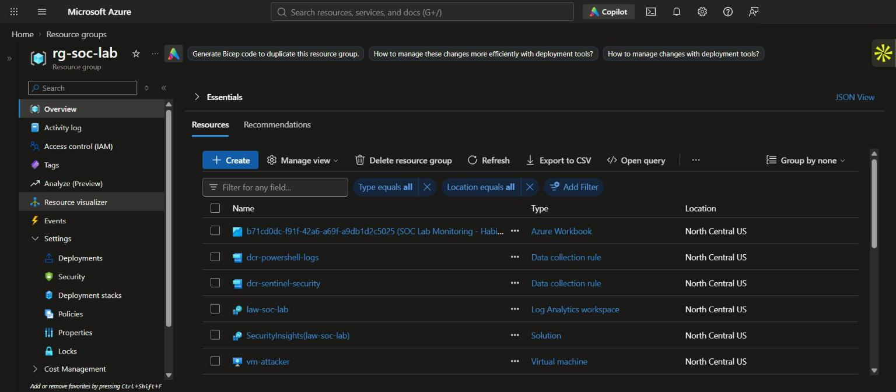

---

### 2. The Target and the Attacker

These are my two virtual machines. `vm-soc-win` (172.16.0.4) is the Windows server I'm protecting, and `vm-attacker` (172.16.1.4) plays the hacker. They sit on the same private network, like an infected laptop on an office network trying to break into a server.

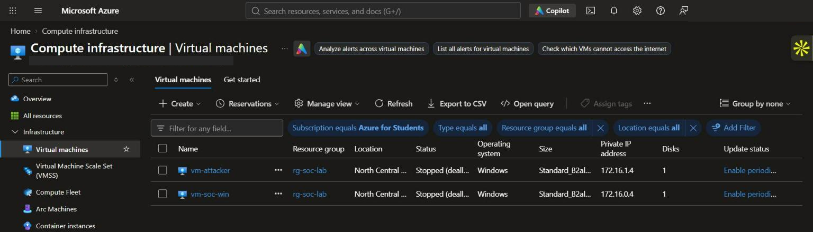

---

### 3. Locking Down RDP with an NSG

This network security group controls who can connect to the server. Only my own IP address can use Remote Desktop, so bots on the internet can't try to guess my password. Notice the default AllowVnetInBound rule: traffic inside the private network is allowed, which is how the attacker machine could reach the server.

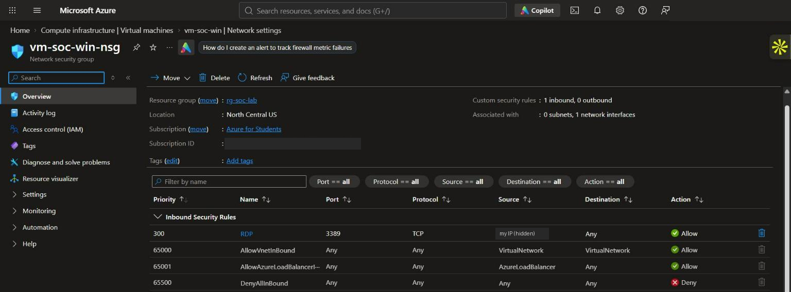

---

### 4. Microsoft Sentinel on My Workspace

This is Microsoft Sentinel running on top of my Log Analytics workspace, `law-soc-lab`. The workspace is the database that stores every log, and Sentinel adds the security tools on top: detection rules, incidents, automation and dashboards.

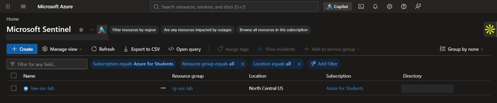

---

### 5. Collecting Windows Security Events

This connector uses the Azure Monitor Agent to send the server's Windows Security logs to Sentinel. I picked the "Common" event set, which includes logins, new accounts and group changes without flooding the workspace. These logs land in the `SecurityEvent` table, which my rules search.

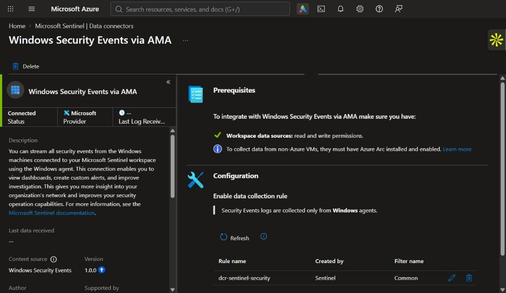

---

### 6. Collecting PowerShell Script Blocks

Attackers love PowerShell, so I turned on Script Block Logging on the server. It records the exact text of every PowerShell command as Event 4104. This second data collection rule uses an XPath filter to send those events to Sentinel, because the security connector doesn't collect them.

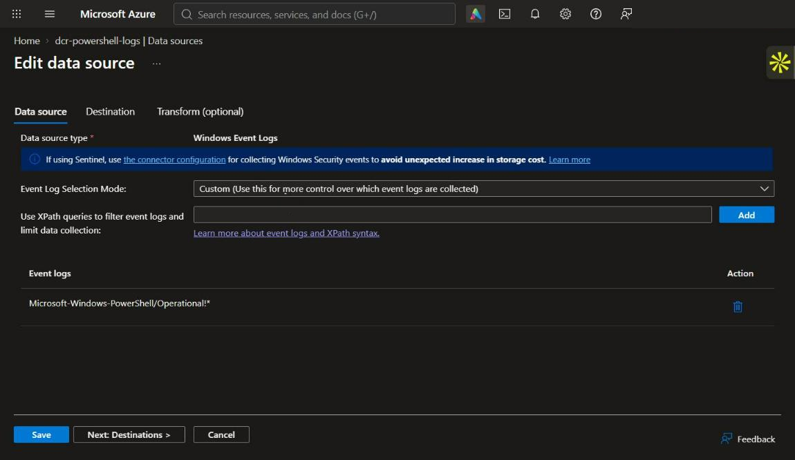

---

### 7. How the Data Collection Rules Connect

This shows how the logs flow. My two data collection rules pull Windows Security events and PowerShell logs from `vm-soc-win` and send them to the `law-soc-lab` workspace, where Sentinel reads them.

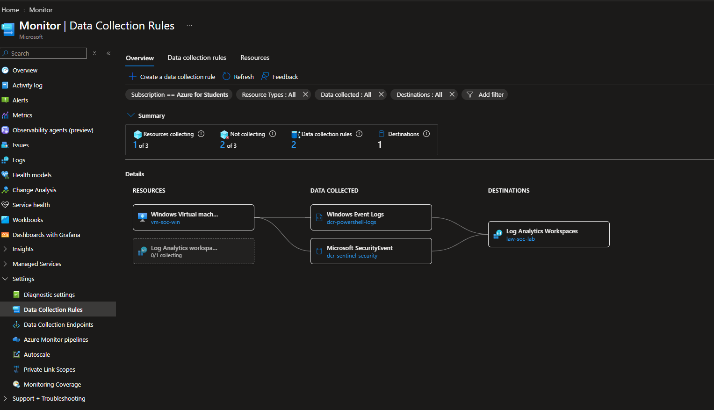

---

### 8. Proving the Data Arrives

Before writing any rules, I checked that the data was actually there. During the attack window this query found failed logins (4625), successful logins (4624), new accounts (4720), a group change (4732) and PowerShell commands (4104), all arriving in Sentinel.

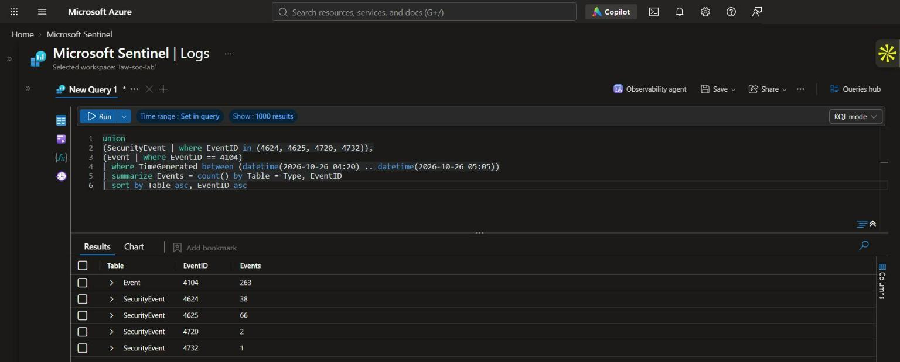

---

### 9. Five Custom Detection Rules

These are my analytics rules. Each one watches for a different stage of an attack: password guessing, a successful login after guessing, suspicious PowerShell, a new account, and an account added to the Administrators group. The sixth rule is Microsoft's built-in "Advanced Multistage Attack Detection" rule.

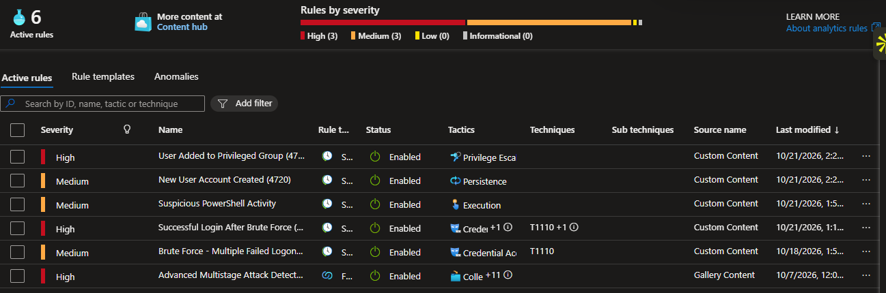

---

### 10. Rule Logic and the 20-Minute Lookback

This rule runs every 5 minutes but searches the last 20 minutes of logs. PowerShell logs were showing up late, and with a 5-minute window they slipped through unchecked. That fix created a new problem I explain later: the same event got caught by several runs in a row.

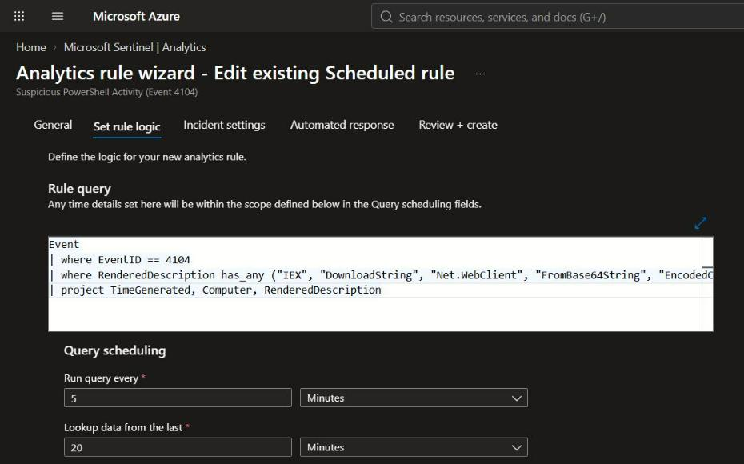

---

### 11. The AutoDisableAndNotify Playbook

This is my automated response playbook, built in Azure Logic Apps. When Sentinel raises an incident, it gets the accounts involved, disables the account on the server, and emails me an alert.

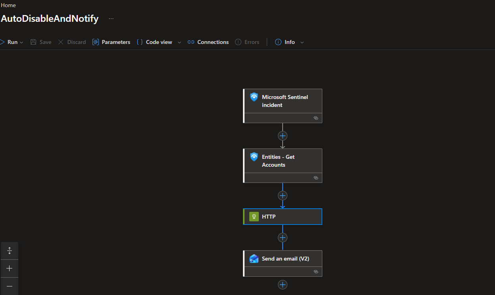

---

### 12. Run Command with a Managed Identity

This step tells Azure to run a PowerShell command inside the server that disables the hacked account. The playbook signs in with its own managed identity, which only has permission to manage this one server. No passwords or keys are stored anywhere.

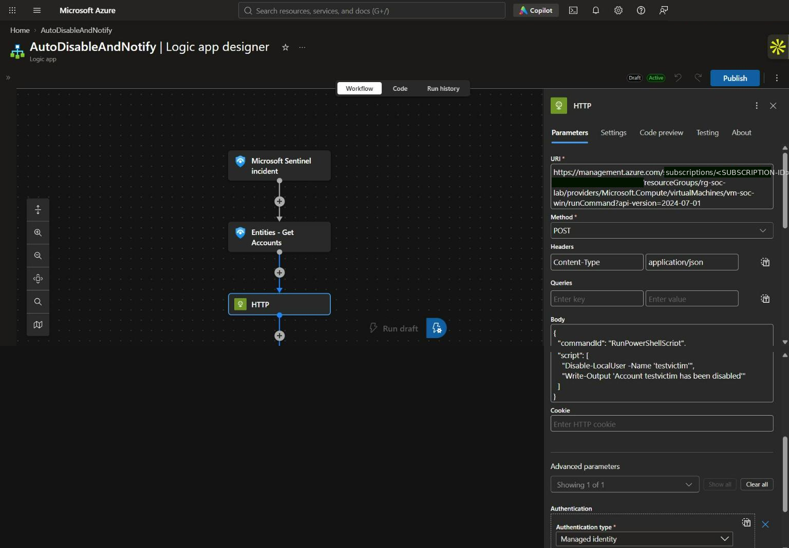

---

### 13. Letting Sentinel Run Playbooks

At first my playbook wouldn't run and threw a permission error. Sentinel has to be given permission before it can trigger a playbook, so I granted it access to the `rg-soc-automation` resource group where the playbook lives.

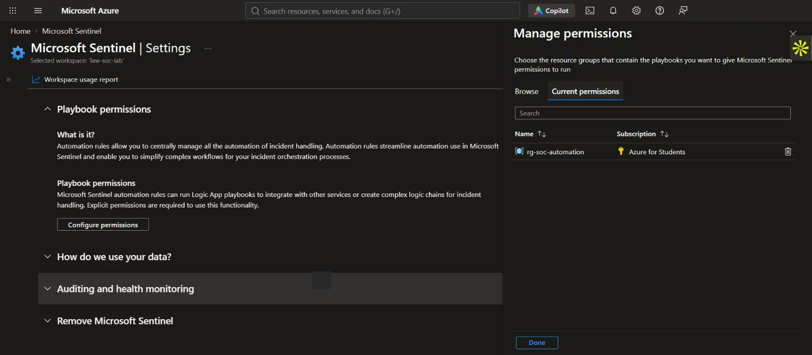

---

### 14. The Automation Rule

This automation rule connects detection to response. When the "Successful Login After Brute Force" rule creates an incident, it automatically runs my playbook. I tied it to that rule because a successful login after many failures is the strongest sign of a real breach.

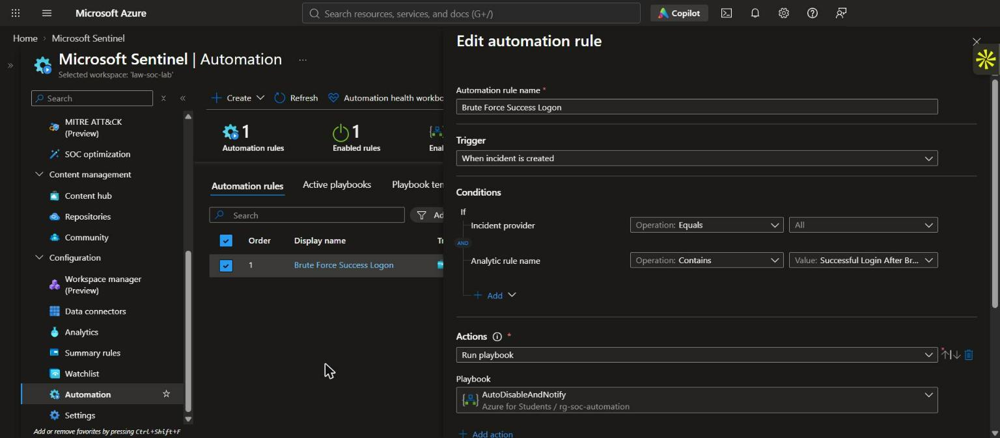

---

### 15. The Brute Force, as the Logs Saw It

From the attacker machine, I guessed passwords against two accounts over the network. This chart shows the failed logins from 172.16.1.4 between 04:26 and 04:36 UTC, then a successful login as `testvictim`. To make the attack possible, I opened file sharing in the server's firewall and turned off account lockout.

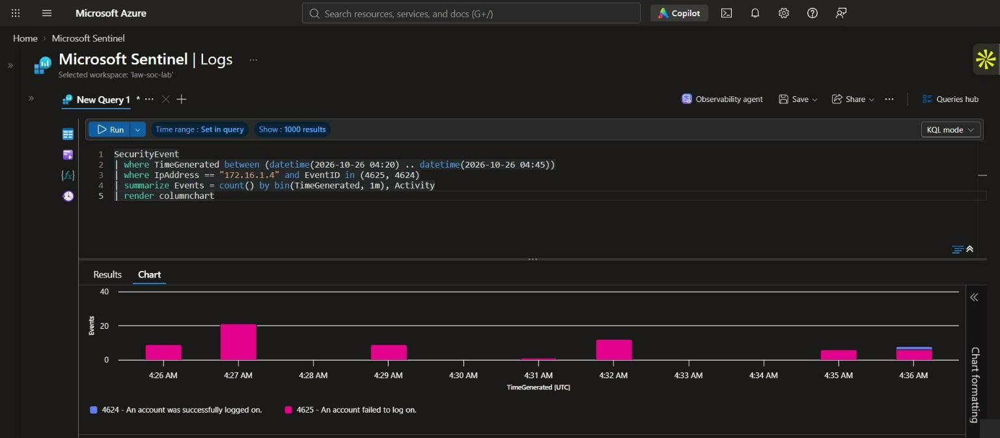

---

### 16. PowerShell and a Backdoor Admin

About two minutes after breaking in, the "attacker" ran suspicious PowerShell (04:38 UTC), created an account called `backdoor_svc`, and added it to the Administrators group (04:39 UTC). That covers three attack stages, execution, persistence and privilege escalation, and each one has its own detection rule.

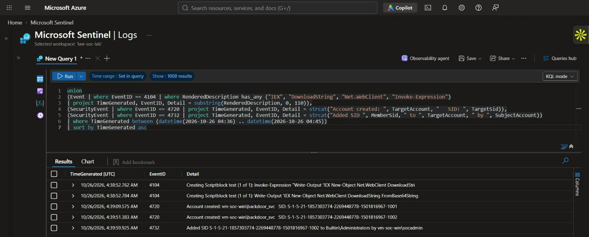

---

### 17. The Incident Queue

This is what an analyst sees at the start of a shift. Notice the High severity incident for the new admin account, and the run of "Suspicious PowerShell Activity" incidents. Those are the same activity counted several times, because each event was caught by more than one rule run. That's alert noise I'd fix by only alerting on newly arrived events.

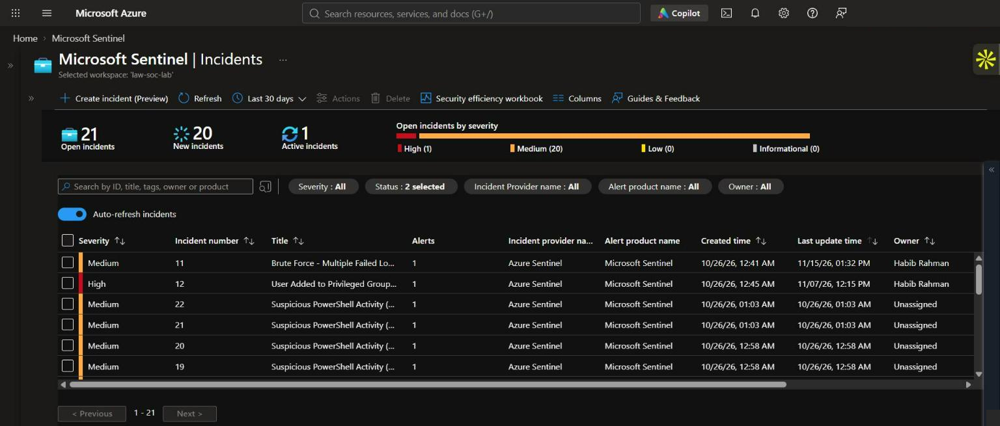

---

### 18. Automated Containment

When the playbook ran, it sent me this alert email and disabled the `testvictim` account on the server through Run Command. One limitation: the account name is fixed in the playbook, and the attacker's `backdoor_svc` admin account was not touched, so a real SOC would still need to remove it.

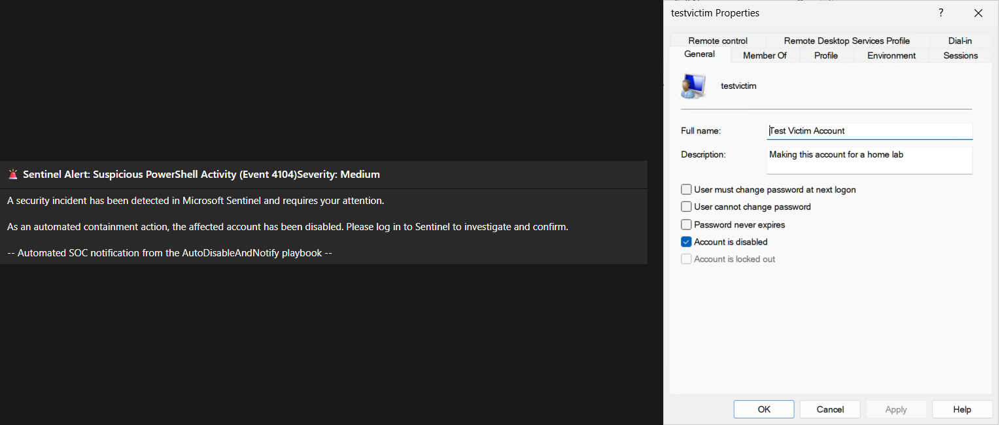

---

### 19. Confirming the Breach with KQL

To confirm what happened, I searched everything the attacker's IP address did. It shows 64 failed logins against `administrator` and `testvictim`, then successful logins as `testvictim` from the same IP. Many failures followed by a success from the same source means the password was guessed.

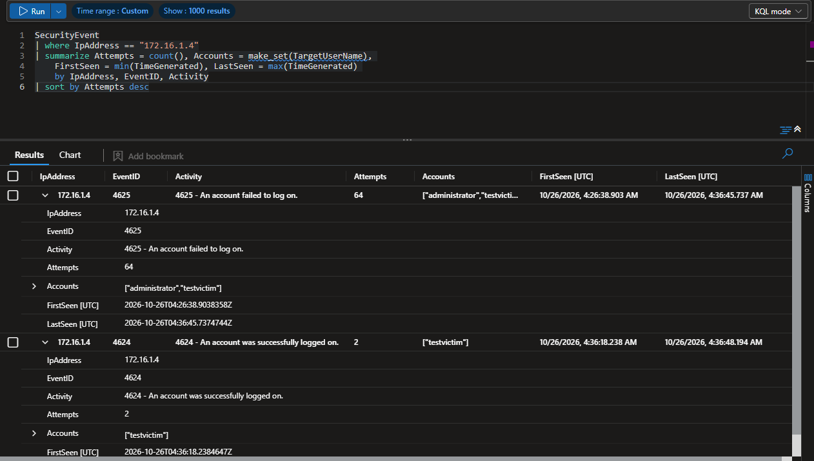

---

### 20. The Detection That Didn't Fire

My "Successful Login After Brute Force" rule never went off, even though the attacker got in. This query shows why: the failed logins recorded the account as `vm-attacker\testvictim`, but the successful login recorded it as `vm-soc-win\testvictim`. The rule needed the names to match exactly, so it never paired them, and the automation rule never ran.

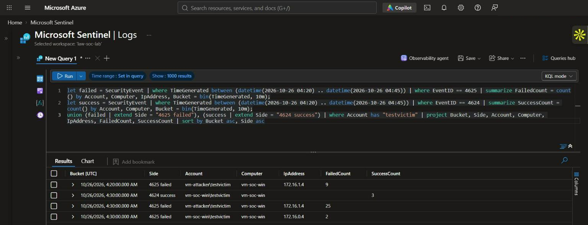

---

### 21. Testing the Fix on the Real Attack

I rewrote the rule to compare just the username and to look for a success shortly after the failures. Then I ran it against the real attack data, and it caught the breach the original rule missed: 34 failed logins from 172.16.1.4, then a successful login at 04:36:18 UTC.

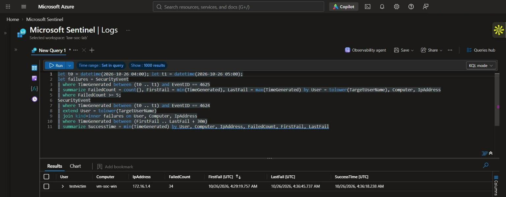

---

### 22. The SOC Lab Monitoring Dashboard

This is the custom Sentinel workbook I built to watch the whole lab on one screen: failed logins, where attacks came from, which accounts were targeted, open incidents, suspicious PowerShell and account changes.

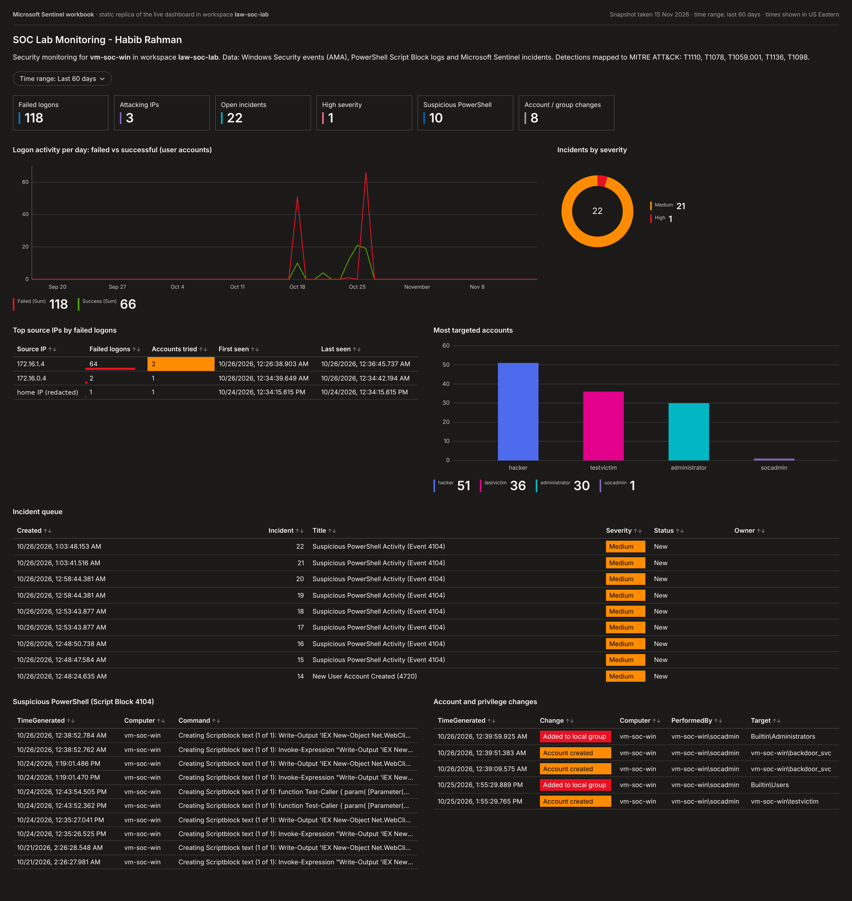
